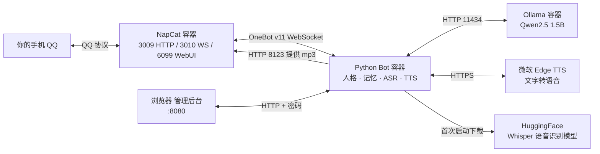

# QQ AI 女儿机器人 · 保姆级部署手册

> 一台 Linux 服务器 + 一个 QQ 小号，照着本文从上往下复制粘贴，就能得到一个会文字聊天、能听语音、能回语音、还会在早上/中午/晚上主动找你说话的 QQ 机器人。
>
> - 难度：零基础可完成（不需要懂 Python，不需要写代码）
> - 耗时：第一次约 30～60 分钟，主要花在下载镜像和模型上
> - 成本：软件全部免费；需要一台能 7×24 开机的 Linux 服务器（2 核 4G 起步）

> ⚠️ **先看系统要求**：本方案使用 `network_mode: host` 和 Docker 网桥地址 `172.17.0.1`，**只适用于 Linux**（云服务器、NAS、软路由、WSL2 里的 Ubuntu 都可以）。Windows / macOS 上的 Docker Desktop 不能直接照搬；Windows 用户请准备一台 Linux 云服务器，或在 WSL2 中安装 Docker Engine 后再按本文操作。
>
> 🖥️ 部署完成后，浏览器打开 `http://服务器IP:8080` 即可进入**网页管理后台**，换模型、改人设、换音色、改 QQ WS 都不用再改文件。详见 [6.5](#65-网页管理后台不用改配置文件)。

---

## 目录

- [0. 先搞清楚：这套东西由什么组成](#0-先搞清楚这套东西由什么组成)
- [1. 准备清单（开始前 10 分钟）](#1-准备清单开始前-10-分钟)
- [2. 安装 Docker](#2-安装-docker)
- [3. 放置文件，搭好目录](#3-放置文件搭好目录)
- [4. 启动 Ollama（机器人的“大脑”）](#4-启动-ollama机器人的大脑)
- [5. 部署 NapCat（机器人的“QQ 账号”）](#5-部署-napcat机器人的qq-账号)
- [6. 构建并启动 Bot（机器人的“人格”）](#6-构建并启动-bot机器人的人格)
  - [6.5 网页管理后台](#65-网页管理后台不用改配置文件)
- [7. 验收：让它开口说话](#7-验收让它开口说话)
- [8. 使用手册：命令、语音模式、主动陪伴](#8-使用手册命令语音模式主动陪伴)
- [9. 日常运维：日志、更新、备份、迁移](#9-日常运维日志更新备份迁移)
- [10. 环境变量大全](#10-环境变量大全)
- [11. 它是怎么工作的（原理，可跳过）](#11-它是怎么工作的原理可跳过)
- [12. 故障排查（按现象查）](#12-故障排查按现象查)
- [13. 安全与合规](#13-安全与合规)
- [14. 完全卸载](#14-完全卸载)
- [附录 A：NapCat 的 docker-compose 全文](#附录-anapcat-的-docker-compose-全文)
- [附录 B：宿主机 / 容器路径对照表](#附录-b宿主机--容器路径对照表)
- [附录 C：相对旧版的变化与已知坑](#附录-c相对旧版的变化与已知坑)
- [附录 D：部署完成检查清单](#附录-d部署完成检查清单)

---

## 0. 先搞清楚：这套东西由什么组成

机器人不是一个程序，而是 **3 个容器 + 1 个 QQ 号** 配合工作。你不需要理解细节，但出问题时知道该看谁很重要。

| 组件 | 通俗解释 | 本项目里的位置 | 对外端口 |
| --- | --- | --- | --- |
| **NapCat** | 机器人的“手和耳朵”：登录 QQ、收消息、发消息、收发语音 | `QQ/docker-compose-qq.yml`（配套目录） | 3009 / 3010 / 6099 |
| **Ollama** | 机器人的“大脑”：在本机运行大语言模型（Qwen2.5） | 本仓库根目录 `docker-compose.yml` | 11434 |
| **Python Bot** | 机器人的“人格和记忆”：决定怎么回、回什么、什么时候主动说话；负责语音识别、语音合成和网页后台 | `python-qq/` | 8123 / 8080 |
| **QQ 小号** | 机器人对外展示的账号 | 你在 NapCat 里扫码登录 | — |

它们之间的关系：



**用一句话理解数据流**：你在 QQ 发一句话 → NapCat 收到后通过 WebSocket 转给 Bot → Bot 去问 Ollama 怎么回答 → Bot 把回答发回 NapCat → NapCat 用机器人的 QQ 号发给你。语音消息则多两步：先由 Whisper 转成文字，回答再由 Edge TTS 转成 mp3，NapCat 再作为语音发出去。

### 机器人有哪些能力

- 私聊文字聊天，带最近 12 条上下文记忆
- 私聊语音消息 → 自动转文字（中文）
- 私聊语音回复（可选，默认文字）
- 群聊里被 @ 时回复（群聊只回文字）
- 自定义角色：`/角色 温柔姐姐`、`/角色 默认`
- 每天早/中/晚三个时段，在你 4 小时没说话时主动关心你
- 网页管理后台：不改配置文件就能换模型、人设、音色和 QQ WS 连接，配置重启不丢
- 聊天记录和大模型推理都在你自己的服务器上，不经过第三方 AI 接口（语音合成除外，见第 13 章）

---

## 1. 准备清单（开始前 10 分钟）

### 1.1 你需要准备

| 项目 | 要求 | 说明 |
| --- | --- | --- |
| Linux 服务器 | x86_64，Ubuntu 20.04+ / Debian 11+ 最省心 | 云服务器、家里的 NAS、旧笔记本装 Ubuntu 都行 |
| CPU / 内存 | 2 核 4G 起步，4 核 8G 更流畅 | 1.5B 模型在 CPU 上跑，内存低于 4G 会很吃力 |
| 硬盘 | 至少 15 GB 空闲 | 镜像约 6 GB，模型约 2 GB，聊天数据会慢慢增长 |
| 网络 | 能访问 Docker Hub / PyPI / HuggingFace / 微软 TTS | 国内服务器可能需要镜像加速或代理，见 2.3 |
| QQ 账号 | **建议专门注册一个小号** | 有被腾讯风控的风险，不要用主号，后果自负 |
| 手机 QQ | 用于扫码登录 | 登录后手机端可能被挤下线，属正常现象 |
| 一个 SSH 工具 | FinalShell / MobaXterm / Xshell / 系统自带终端 | 用来连服务器、传文件 |

### 1.2 关于 QQ 账号的重要提醒

- 本项目通过 NapCat 模拟 QQ 客户端登录，**不是腾讯官方机器人接口**，存在账号被限制/冻结的可能。请务必使用小号，并遵守 QQ 用户协议。
- 一个 QQ 号同一时间只能在一处登录。NapCat 登录后，手机 QQ 可能被踢下线；部分版本支持“平板模式”共存，但不保证。
- 新注册的 QQ 不要立刻高频加群、发消息，先正常养几天再挂机器人，能显著降低风控概率。
- 不要用机器人发广告、刷屏、加大量好友，这类行为最容易封号。

### 1.3 本文的路径约定

本文所有命令都假设：

- 你以 **root** 用户登录服务器；
- 项目根目录是 **`/root/docker-compose`**；
- NapCat 在 `/root/docker-compose/QQ`；
- 本仓库在 `/root/docker-compose/qq-ai-bot`。

如果你用普通用户，把文中所有 `/root` 换成 `/home/你的用户名`，并同步修改 `python-qq/docker-compose.yml` 里那行绝对路径（第 3.3 节会讲）。

> 💡 路径不必和本文完全一样，但 **`python-qq/docker-compose.yml` 里挂载 NapCat 数据的绝对路径必须和真实路径一致**，这是新手最容易翻车的地方。

---

## 2. 安装 Docker

如果服务器上已经有 Docker，跳到 2.3 验证即可。

### 2.1 一键安装（Ubuntu / Debian / CentOS）

```bash
# 官方安装脚本，使用阿里云镜像下载
curl -fsSL https://get.docker.com | bash -s docker --mirror Aliyun

# 启动 Docker，并设置开机自启
systemctl enable --now docker

# 验证
docker --version
docker compose version
```

> 如果提示 `curl: command not found`，先执行 `apt-get update && apt-get install -y curl`。

成功的输出类似：

```text
Docker version 27.3.1, build ce12230
Docker Compose version v2.30.3
```

> 只要看到 `Docker Compose version v2.x` 就说明 `docker compose` 命令可用。**注意是 `docker compose`（中间空格），不是老教程里的 `docker-compose`（中间横杠）。**

如果提示 `docker compose` 不存在，补装插件：

```bash
apt-get update && apt-get install -y docker-compose-plugin
```

### 2.2 测试 Docker 是否能正常拉镜像

```bash
docker run --rm hello-world
```

看到 `Hello from Docker!` 就成功了。

如果卡在 `Unable to find image ... pull access denied` 或长时间没反应，说明拉不到 Docker Hub，继续看 2.3。

### 2.3 国内网络：配置镜像加速（可选但强烈建议）

编辑（或新建）`/etc/docker/daemon.json`。**如果文件已经存在，请手动把 `registry-mirrors` 合并进去，不要直接覆盖原有配置**；只有文件不存在时才用下面的命令整体创建：

```bash
mkdir -p /etc/docker
cat > /etc/docker/daemon.json <<'EOF'
{
  "registry-mirrors": [
    "https://docker.1ms.run",
    "https://docker.m.daocloud.io"
  ]
}
EOF

systemctl daemon-reload
systemctl restart docker
```

然后重新执行 `docker run --rm hello-world` 验证。

> 镜像加速站会失效、限流或更换域名，这是常态。如果上面两个都不能用，请换成你所用云厂商（阿里云、腾讯云、华为云）提供的专属加速地址，或给服务器配置代理。**本文不保证任何第三方加速站长期可用。**

### 2.4 安装 Docker 的常见问题

| 现象 | 原因 | 解决 |
| --- | --- | --- |
| `docker: command not found` | 没装成功或 PATH 问题 | 重跑 2.1；`which docker` 检查 |
| `Cannot connect to the Docker daemon` | Docker 服务没启动 | `systemctl start docker` |
| `permission denied /var/run/docker.sock` | 当前用户不在 docker 组 | 用 root，或 `usermod -aG docker $USER` 后重新登录 |
| `docker compose` 不存在 | 只装了旧版 compose | 装 `docker-compose-plugin` |
| 拉镜像超时 | 网络问题 | 2.3 配置加速或代理 |

---

## 3. 放置文件，搭好目录

### 3.1 最终的目录结构

请把文件整理成下面这样（这是最省事的结构，后面所有命令都基于它）：

```text
/root/docker-compose/
├── QQ/                                  # NapCat（第 5 章创建/上传）
│   ├── docker-compose-qq.yml
│   ├── .env                             # NAPCAT_UID / NAPCAT_GID
│   ├── data/
│   │   ├── QQ/                          # QQ 账号数据（扫码后生成）
│   │   └── napcat/config/               # NapCat 配置
│   └── logs/
└── qq-ai-bot/                           # 本仓库
    ├── README.md                        # 本文
    ├── docker-compose.yml               # Ollama
    ├── ollama_data/                     # 首次启动后自动生成（大模型）
    └── python-qq/
        ├── README.md                    # Bot 模块说明
        ├── docker-compose.yml           # Bot
        ├── Dockerfile
        ├── requirements.txt
        ├── bot.py
        ├── admin.py                     # 网页后台（配置 / API / 登录）
        ├── admin.html                   # 后台页面
        ├── tests/                       # 自动化测试（不进镜像）
        ├── data/                        # 自动生成，bot.db
        ├── audio/                       # 自动生成，临时 mp3
        └── models/                      # 自动生成，Whisper 模型
```

### 3.2 把文件传上去

在你自己的电脑上，项目文件位于：

- 本仓库（`qq-ai-bot` 文件夹）：里面有 `docker-compose.yml` 和 `python-qq/`
- 配套的 NapCat 文件夹 `QQ`：里面有 `docker-compose-qq.yml`

用 FinalShell / WinSCP / MobaXterm 的 SFTP 功能，把这两个文件夹上传到 `/root/docker-compose/` 下，保证最终结构和 3.1 一致。

> 💡 如果你是从 Windows 上传，建议用“二进制/自动”模式，避免脚本换行符被改坏。上传后在服务器上执行一次：
>
> ```bash
> find /root/docker-compose -name "*.yml" -o -name "*.yaml" | xargs sed -i 's/\r$//'
> ```
>
> 这会把 Windows 的 CRLF 换行统一成 Linux 的 LF，避免 compose 报莫名其妙的语法错。

没有 NapCat 文件夹？直接看 [附录 A](#附录-anapcat-的-docker-compose-全文)，手动创建 `docker-compose-qq.yml` 即可。

### 3.3 只需要检查/修改这 3 个地方（重要）

先别急着启动，检查下面三处。改完再继续，能省掉 90% 的报错。

> 💡 不会用 `vi`？在服务器上执行 `nano 文件路径`，改完按 `Ctrl + O`、回车保存，再按 `Ctrl + X` 退出；或者用 FinalShell / WinSCP 自带的文本编辑器直接改。

#### ① Ollama 的代理设置

打开 `/root/docker-compose/qq-ai-bot/docker-compose.yml`，找到：

```yaml
    environment:
      HTTP_PROXY: http://127.0.0.1:7890
      HTTPS_PROXY: http://127.0.0.1:7890
      NO_PROXY: localhost,127.0.0.1,172.17.0.1
```

- 服务器上 **确实有** 127.0.0.1:7890 的代理（比如 Clash）→ 保持不动；端口不同就改端口。
- 服务器上 **没有代理** → **把这三行删掉**。否则 Ollama 下载模型时会报 `connection refused 127.0.0.1:7890`。

#### ② Bot 里挂载 NapCat 数据的绝对路径

打开 `/root/docker-compose/qq-ai-bot/python-qq/docker-compose.yml`，找到：

```yaml
      - /root/docker-compose/QQ/data/QQ:/napcat-qq-data:ro
```

如果你的 NapCat 不在 `/root/docker-compose/QQ`，把左边改成真实路径。可以用下面的命令确认路径存在（首次部署时里面是空的，扫码登录后才会生成数据）：

```bash
ls /root/docker-compose/QQ/data/QQ
```

Bot 本身放在哪个目录都行（比如旧的 `/root/docker-compose/ai-bot/python-qq`），只要这行绝对路径指向真实的 NapCat 数据目录即可。

> ❗ 如果路径写错，Docker 会“好心”地自动创建一个空目录，容器不会报错，但语音识别会一直失败。这是最隐蔽的坑。

#### ③ Bot 的模型名和音色

同一个文件里：

```yaml
      - OLLAMA_MODEL=qwen25-1.5b:latest
      - TTS_VOICE=zh-CN-XiaoshuangNeural
```

- `OLLAMA_MODEL` 必须和 `docker exec -it ollama ollama list` 里显示的名字**一模一样**。第 4 章会教你创建一个叫 `qwen25-1.5b:latest` 的别名。
- `TTS_VOICE` 建议改成 **`zh-CN-XiaoyiNeural`**。原因见 [附录 C](#附录-c相对旧版的变化与已知坑)：`zh-CN-XiaoshuangNeural` 是微软付费音色，Edge TTS 免费接口里没有，启动时会提示 `voice NOT available`，虽然能自动回退，但日志会一直报警。启动后也可以直接在网页后台「语音」页改（见 6.5），不用改这里。

改完后可以用一条命令确认：

```bash
cd /root/docker-compose/qq-ai-bot/python-qq
grep -n -E "OLLAMA_MODEL|TTS_VOICE|QQ/data/QQ" docker-compose.yml
```

---

## 4. 启动 Ollama（机器人的“大脑”）

### 4.1 启动容器

> ⚠️ 如果 `docker ps` 里已经有一个叫 `ollama` 的容器在跑，**不要重复启动**（会端口冲突 / 容器名冲突）。直接跳到 4.2 检查模型即可，Bot 默认就会连 `127.0.0.1:11434`。

```bash
cd /root/docker-compose/qq-ai-bot
docker compose up -d
docker compose ps
```

`docker compose ps` 里 `ollama` 的状态应该是 `Up`。第一次会下载镜像，耐心等。

看日志：

```bash
docker compose logs --tail=50 ollama
```

正常会看到类似：

```text
Ollama server listening on 0.0.0.0:11434
```

### 4.2 下载中文模型

机器人默认用 Qwen2.5 1.5B：中文不错、CPU 也能跑、内存占用约 1～2 GB。

```bash
# 下载官方模型（约 1 GB）
docker exec -it ollama ollama pull qwen2.5:1.5b

# 关键一步：给模型创建一个和 compose 里一致的别名
docker exec -it ollama ollama cp qwen2.5:1.5b qwen25-1.5b:latest

# 确认
docker exec -it ollama ollama list
```

`ollama list` 里应该能看到：

```text
NAME                       ID              SIZE      MODIFIED
qwen25-1.5b:latest         xxxxxxxxxxxx    986 MB    ...
qwen2.5:1.5b               xxxxxxxxxxxx    986 MB    ...
```

> 两个名字共享同一份模型文件，不会占用双倍硬盘。
>
> 如果你不想创建别名，也可以把 `python-qq/docker-compose.yml` 里的 `OLLAMA_MODEL` 直接改成 `qwen2.5:1.5b`，效果一样。

### 4.3 测试大脑是否正常

```bash
curl -s http://127.0.0.1:11434/api/tags
```

能看到一大段 JSON、里面有 `qwen25-1.5b:latest` 就对了。

再让它说句话：

```bash
curl -s http://127.0.0.1:11434/api/chat -d '{
  "model": "qwen25-1.5b:latest",
  "messages": [{"role": "user", "content": "用一句话介绍你自己"}],
  "stream": false
}'
```

返回的 JSON 里 `"content"` 字段就是模型生成的文字。第一次回答可能需要 5～20 秒（模型要加载进内存），之后会快一些。

### 4.4 下载失败怎么办

| 报错关键词 | 原因 | 解决 |
| --- | --- | --- |
| `connection refused` + `127.0.0.1:7890` | 配了代理但服务器没有代理 | 删掉 compose 里的 `HTTP_PROXY` / `HTTPS_PROXY` / `NO_PROXY`，`docker compose up -d` 重建 |
| `dial tcp ... timeout` | 连不上 ollama.com | 配置服务器代理，或换能访问外网的网络 |
| `no space left on device` | 硬盘满 | `df -h` 检查，清理空间 |
| `model requires more system memory` | 内存不够 | 换更小的 `qwen2.5:0.5b`，并同步改 `OLLAMA_MODEL` |
| `pull model manifest: file does not exist` | 模型名写错 | 官方名字是 `qwen2.5:1.5b`（有点号），不是 `qwen2.5-1.5b` |

### 4.5 可选：升级模型 / 使用显卡

- 内存 8G 以上、想要更聪明：`docker exec -it ollama ollama pull qwen2.5:3b`，然后把 `OLLAMA_MODEL` 改成 `qwen2.5:3b` 并重启 Bot。CPU 上 3B 会明显变慢。
- 有 NVIDIA 显卡：安装 `nvidia-container-toolkit` 后，可以给 ollama 服务加 GPU 预留（非必需，本文不展开）。

---

## 5. 部署 NapCat（机器人的“QQ 账号”）

NapCat 负责真正登录 QQ。这一步需要你用手机扫码，**请在电脑前操作**。

> ⚠️ 如果 `docker ps` 里已经有 `napcat` 在跑，说明你之前部署过，直接跳到 5.3 检查登录状态和 5.4 的 WebSocket 配置，不要重复创建容器。下面 5.1 / 5.2 只适用于全新安装。

### 5.1 创建目录和环境变量

```bash
cd /root/docker-compose/QQ

# NapCat 会以这个 UID/GID 写文件，填当前登录用户即可
printf 'NAPCAT_UID=%s\nNAPCAT_GID=%s\n' "$(id -u)" "$(id -g)" > .env

mkdir -p data/QQ data/napcat/config logs
chown -R "$(id -u):$(id -g)" data logs

cat .env
```

输出示例（root 用户是 0，普通用户通常是 1000 左右，以你机器实际输出为准）：

```text
NAPCAT_UID=0
NAPCAT_GID=0
```

### 5.2 启动 NapCat

```bash
docker compose -f docker-compose-qq.yml up -d
docker compose -f docker-compose-qq.yml ps
```

第一次会拉取 `mlikiowa/napcat-docker:latest` 镜像。看到 `napcat` 状态为 `Up` 即可。

### 5.3 打开 WebUI 并登录 QQ

先看日志，找 WebUI 的 Token：

```bash
docker logs napcat 2>&1 | grep -i -E "token|webui|6099"
```

你会看到类似：

```text
[WebUi] WebUi Token: 1a2b3c4d5e6f...
[WebUi] WebUi listening on 0.0.0.0:6099
```

然后二选一打开 WebUI：

**方式 A：服务器有公网 IP，且安全组/防火墙放行了 6099**

浏览器访问：

```text
http://你的服务器IP:6099/webui
```

**方式 B（更安全，推荐）：用 SSH 隧道，不对外暴露 6099**

在你自己的电脑上执行：

```bash
ssh -L 6099:127.0.0.1:6099 root@你的服务器IP
```

保持这个 SSH 窗口不要关，然后在浏览器访问：

```text
http://127.0.0.1:6099/webui
```

> 不同 NapCat 版本的页面路径可能是 `http://IP:6099` 或 `http://IP:6099/webui`，两个都试试。登录时把日志里的 Token 粘贴进去；登录后建议在设置里改成一个你自己记得住的密码。如果日志里完全找不到 Token，直接在浏览器打开 WebUI，按页面提示首次设置一个即可。

登录步骤：

1. 进入 WebUI，找到「二维码」页面（有的版本在首页直接显示）；
2. 打开手机 QQ → 右上角「+」→「扫一扫」，扫描屏幕上的二维码；
3. 手机上点「确认登录」；
4. 回到服务器看日志，出现类似 `登录成功` / `账号 xxx 已上线` 就成功了。

> 如果二维码过期，刷新页面重新扫。如果提示需要滑块验证或设备验证，按手机上的提示完成即可。
>
> 登录成功后，手机 QQ 可能被挤下线，这是正常的：同一个号不能两处同时在线。

### 5.4 配置 OneBot WebSocket（关键一步）

Bot 要通过 WebSocket 和 NapCat 通信，必须手动开一个“网络配置”。

在 NapCat WebUI 里：

1. 左侧菜单找到 **「网络配置」**（有的版本叫「网络设置」）；
2. 点 **「新建」** → 选择 **「WebSocket 服务器」**（WebSocket Server）；
3. 按下面填写：

| 字段 | 填什么 | 说明 |
| --- | --- | --- |
| 名称 | `qq-bot` | 随便起 |
| Host / 监听地址 | `0.0.0.0` | 不要填 127.0.0.1 |
| 端口 / Port | `3001` | 对应宿主机 3010，别改 |
| Token / 令牌 | `cyj123456` | 要和 Bot 的 `WS_TOKEN` 一致 |
| 消息格式 | `array` | 数组格式，Bot 已兼容 |
| 上报自身消息 | 关闭 | 否则机器人可能自问自答 |

4. 保存，并确认这一项的状态是 **「运行中」/「已启用」**。

> 为什么端口填 3001，Bot 却连 3010？因为 `docker-compose-qq.yml` 里做了端口映射 `3010:3001`：**宿主机 3010 → 容器 3001**。Bot 运行在宿主机网络里，所以连 3010。
>
> 如果你改了映射，就要同步改 Bot 的 `WS_URL`。

### 5.5 （可选但推荐）开启 HTTP 接口，方便自检

同一个「网络配置」页面，再新建一个 **「HTTP 服务器」**：

- Host / 监听地址：`0.0.0.0`
- 端口：`3000`
- Token：`cyj123456`
- 启用

开启后你就可以用 curl 自检；原 `docker-compose-qq.yml` 的健康检查写法有误，修正方法见下方提示：

```bash
# 看运行状态
curl -s -H "Authorization: Bearer cyj123456" http://127.0.0.1:3009/get_status

# 看登录的 QQ 信息
curl -s -H "Authorization: Bearer cyj123456" http://127.0.0.1:3009/get_login_info
```

正常返回类似：

```json
{"status":"ok","retcode":0,"data":{"user_id":123456789,"nickname":"你的机器人"}}
```

如果返回 `401`，说明 Token 不一致；如果 `Connection refused`，说明 HTTP 服务器没启用或端口不对。

> ⚠️ 原 `docker-compose-qq.yml` 的 healthcheck 把 URL 和 `-H` 写在了同一个参数里（`curl` 会报 `URL rejected: Malformed input`），所以 **无论 HTTP 服务器开没开，NapCat 都会显示 `unhealthy`**。这不影响收发消息。想让状态变绿，把 `test:` 那一行改成：
>
> ```yaml
>       test: ["CMD-SHELL", "curl -fsS -H 'Authorization: Bearer cyj123456' http://localhost:3000/get_status || exit 1"]
> ```
>
> 然后 `docker compose -f docker-compose-qq.yml up -d` 重建。

### 5.6 NapCat 这一步的检查点

- [ ] `docker ps` 里 `napcat` 是 `Up`
- [ ] WebUI 能打开，QQ 已登录成功
- [ ] 网络配置里 WebSocket 服务器（3001，token `cyj123456`）是「运行中」
- [ ] `curl .../get_login_info` 能返回你的机器人 QQ 号

四项都满足再往下走。

---

## 6. 构建并启动 Bot（机器人的“人格”）

### 6.1 构建镜像

```bash
cd /root/docker-compose/qq-ai-bot/python-qq
docker compose up -d --build
```

第一次构建要装 `faster-whisper`、`edge-tts` 等依赖，**大约 3～15 分钟**，屏幕会滚动大量 pip 输出，属正常现象。

构建完成后查看状态：

```bash
docker compose ps
```

> 如果反复重建时提示 `Sending build context to Docker daemon ...` 很大、很慢，可以在 `python-qq/` 下新建一个 `.dockerignore`，写入 `data/`、`audio/`、`models/` 三行，避免把运行数据打进构建上下文。
>
> 如果构建卡在 `pip install` 或报 `Read timed out`，把 `Dockerfile` 里这一行改成国内源：
>
> ```dockerfile
> RUN pip install --no-cache-dir -i https://pypi.tuna.tsinghua.edu.cn/simple -r requirements.txt
> ```
>
> 如果第一步 `FROM swr.cn-north-4.myhuaweicloud.com/...` 拉取失败，把 `Dockerfile` 第一行改成 `FROM python:3.12-slim`（前提是服务器能访问 Docker Hub 或已配置镜像加速）。

### 6.2 看启动日志（非常重要）

```bash
docker compose logs -f qwen-qq-bot
```

**一次健康的启动**大致是这样（顺序可能略有差异）：

```text
[DB] database initialized
[WEB] admin listening on 0.0.0.0:8080
[WEB] 浏览器打开 http://服务器IP:8080
[WEB] 首次登录密码: Ab3dEf6hIj9k
[TIME] timezone=Asia/Shanghai, current=2026-10-31 16:00:00
[ASR] loading Whisper tiny (cpu/int8)...
[ASR] Whisper ready
[TTS] voice=zh-CN-XiaoyiNeural, candidates=['zh-CN-XiaoyiNeural', 'zh-CN-XiaoxiaoNeural'], rate=-5%, pitch=+2Hz, volume=+0%, timeout=45s, retries=1
[TTS] voice ok: zh-CN-XiaoyiNeural
[TTS] audio server listening on 0.0.0.0:8123
[TTS] audio cleanup: keep 600s, every 300s
[INFO] connecting NapCat: ws://127.0.0.1:3010
[INFO] NapCat WebSocket connected
[PROACTIVE] morning/noon/evening scheduler started
[PROACTIVE] timezone=Asia/Shanghai, idle=4h
```

逐行解释：

| 日志 | 含义 |
| --- | --- |
| `[DB] database initialized` | 数据库建好了 |
| `[WEB] admin listening` | 网页后台已启动 |
| `[WEB] 首次登录密码` | 只在第一次生成密码时打印，请立刻记下 |
| `[ASR] Whisper ready` | 语音识别模型加载成功 |
| `[TTS] voice ok` | 语音合成音色可用 |
| `audio server listening` | 语音文件服务器已启动（给 NapCat 下载 mp3 用） |
| `NapCat WebSocket connected` | **最关键**：已连上 QQ |
| `[PROACTIVE] ... started` | 主动陪伴定时器已启动 |

> 如果设置了 `ADMIN_PASSWORD`，日志会变成“管理密码使用 ADMIN_PASSWORD 环境变量”，不会打印明文。
>
> 如果卡在 `[ASR] loading Whisper tiny...` 很久，是在从 HuggingFace 下载模型，国内网络可能很慢甚至失败。看 6.3。此时网页后台已经可以打开，不用干等。

按 `Ctrl + C` 退出日志查看（不会停容器）。

### 6.3 国内网络：加速 Whisper 模型下载

如果日志出现：

```text
[ASR] Whisper load failed, voice input disabled: ...
```

说明模型没下载下来。给 Bot 加一个 HuggingFace 镜像地址即可。

编辑 `python-qq/docker-compose.yml`，在 `environment:` 下加一行（缩进对齐其他 `-`）：

```yaml
      - HF_ENDPOINT=https://hf-mirror.com
```

然后重建容器：

```bash
docker compose up -d
docker compose logs -f
```

> 加了镜像后第一次仍需要下载几十 MB（tiny 模型）。下载成功后会缓存在 `./models`，以后重启不再下载。
>
> 如果 tiny 识别不准，可以改成 `WHISPER_MODEL=small`（约 500 MB，内存占用更高、识别更准），改完 `docker compose up -d`。

### 6.4 这一步的检查点

- [ ] `docker compose ps` 里 `qwen-qq-bot` 是 `Up`
- [ ] 日志有 `[ASR] Whisper ready`
- [ ] 日志有 `[TTS] voice ok`
- [ ] 日志有 `[INFO] NapCat WebSocket connected`
- [ ] `http://服务器IP:8080` 能打开网页后台（或 SSH 隧道后能打开）

都满足，就可以去 QQ 里测试了。

### 6.5 网页管理后台（不用改配置文件）

Bot 启动时会额外开一个网页后台，默认端口 **8080**。以后换模型、改人设、换音色、改 QQ 的 WS 地址和 Token，都不需要再 SSH 改 `docker-compose.yml`。

> 8080 是管理后台；8123 是给 NapCat 下载语音文件的内部端口，两者不要混。

#### 打开后台

**方式 A：服务器/局域网能访问 8080**

浏览器打开：

```text
http://你的服务器IP:8080
```

需要先在云安全组或防火墙放行 8080（只建议放行你自己的 IP）。

**方式 B（更安全）：SSH 隧道**

在你自己的电脑上执行：

```bash
ssh -L 8080:127.0.0.1:8080 root@你的服务器IP
```

保持窗口不关，浏览器打开：

```text
http://127.0.0.1:8080
```

#### 第一次登录

密码会打印在 Bot 启动日志里：

```bash
cd /root/docker-compose/qq-ai-bot/python-qq
docker compose logs qwen-qq-bot | grep WEB
```

首次启动会看到类似：

```text
[WEB] admin listening on 0.0.0.0:8080
[WEB] 浏览器打开 http://服务器IP:8080
[WEB] 首次登录密码: Ab3dEf6hIj9k
```

把 `首次登录密码` 后面的字符串填进登录框即可。这个密码只在**第一次生成时**打印一次，之后会以哈希形式保存在 `data/bot.db`，重启不再打印。

如果 compose 里设置了 `ADMIN_PASSWORD`，日志会显示“管理密码使用 ADMIN_PASSWORD 环境变量”，此时密码以环境变量为准。

#### 后台能改什么

| 分区 | 可改内容 | 生效时间 |
| --- | --- | --- |
| QQ 连接 | WebSocket 地址、Token | 保存后自动断开并重连（约 3 秒） |
| AI 设置 | Ollama 地址、模型名、温度、回复长度、人设提示词 | 下一条消息生效 |
| 语音 | 音色、语速、音调、音量 | 下一条语音生效 |
| 安全 | 修改后台密码 | 立即生效，需要重新登录 |

几个细节：

- **AI 设置**里可以点「测试 Ollama 连接」，会显示连接是否成功、当前模型是否在模型列表里。
- **人设提示词**就是 `SYSTEM_PROMPT`，改完保存即可；点「恢复默认」可以还原内置的女儿人设。
- **音色**输入框内置了 20 多个常用中文音色（晓伊、晓晓、云希、云健、东北话、粤语、台湾腔等），点输入框右侧箭头选择，也可以直接输入任意 Edge TTS 音色名。
- `zh-CN-XiaoshuangNeural`（晓双）是 Azure 付费音色，Edge TTS 免费接口里没有；选它时页面会提示，实际会自动回退到备用音色。
- **QQ 连接**保存后，页面右上角的状态会短暂变成“未连接”，随后自动重连；如果一直连不上，检查 Token 和 NapCat 的网络配置。

#### 默认值和“恢复默认”

后台第一次打开时，所有字段都等于当前环境变量的值（也就是你现在能正常运行的配置），不需要重新填。

- 你保存过的值会覆盖环境变量，写入 `data/bot.db` 的 `settings` 表，重启容器仍然有效；
- 点某个分区的「恢复默认」，会删除该分区的覆盖值，重新使用 `docker-compose.yml` 里的环境变量；
- 如果你改了 compose 里的环境变量但后台有旧覆盖值，**后台的值优先**；想用新的环境变量，先在后台点「恢复默认」。

#### 后台改密码 / 忘记密码

- 在「安全」页可以修改密码（至少 8 位），改完当前会话立即失效，需要重新登录。
- 如果忘记密码：在 `python-qq/docker-compose.yml` 里取消这一行注释并改成你的密码，然后重启：

  ```yaml
  - ADMIN_PASSWORD=你的新密码
  ```

  设置 `ADMIN_PASSWORD` 后，网页里不能改密码，密码以环境变量为准。
- 也可以删除数据库里的密码记录（未设置 `ADMIN_PASSWORD` 时会重新生成并打印）：

  ```bash
  docker exec -it qwen-qq-bot python -c "
  import sqlite3
  db = sqlite3.connect('/app/data/bot.db')
  db.execute(\"delete from settings where key='_admin_password_hash'\")
  db.commit()
  "
  docker compose restart
  ```

#### 安全提醒

- 后台只有 HTTP，没有 HTTPS；**不要直接暴露到公网**，优先用 SSH 隧道或只允许自己的 IP 访问 8080。
- 建议登录后在「安全」页把密码改成强密码。
- 连续输错 5 次会锁定 60 秒；这是正常保护，等一分钟再试。
- 后台能改 QQ Token 和模型，等同于服务器控制权，不要把 8080 借给别人。

---

## 7. 验收：让它开口说话

请用你 **自己的 QQ** 加机器人 QQ 为好友，然后按顺序测试。

### 7.1 文字聊天

给机器人发：

```text
你是谁呀？
```

预期：几秒内收到文字回复，且自我介绍是“女儿”而不是“AI 助手”。同时日志出现：

```text
[MESSAGE] type=private user=你的QQ号 voice=False role=乖巧可爱的女儿 replied
```

> 第一次回复可能 10 秒以上，因为模型要加载；之后通常 2～8 秒。

### 7.2 发语音（语音转文字）

按住说话，发一条语音，比如“今天有点累”。

预期：日志出现：

```text
[ASR] user=你的QQ号 logprob=-0.32 no_speech=0.01 lang=0.99 text='今天有点累'
```

然后机器人用 **文字** 回复（默认就是文字，原因见 8.3）。

如果日志出现“没听清”，先确认你说话清晰、环境不吵；仍然不行看 12.6。

### 7.3 让机器人用语音回复

私聊发送：

```text
用语音回复我，今天过得怎么样？
```

预期：先收到一条语音，日志出现：

```text
[TTS] ok voice=zh-CN-XiaoyiNeural size=23456
[TTS] voice sent to 你的QQ号: xxxxx.mp3, size=23456
```

如果语音没发出来、只收到文字，日志会有 `[TTS] voice reply failed, fallback to text`，看 12.7。

### 7.4 开启“持续语音模式”

私聊发送：

```text
接下来用语音回复我
```

预期：先收到一条语音确认“好呀，以后我就用语音陪你聊天啦～”，之后你发的每条私聊都会用语音回复。

恢复文字：

```text
以后用文字回复我
```

### 7.5 群聊测试

1. 把机器人 QQ 拉进一个群（最好是你自己的测试群）；
2. 在群里 **@机器人** 并说话：

```text
@你的机器人 你好呀
```

预期：机器人 @ 你并回复文字。

> 群聊必须 @ 才会理你；不 @ 一律忽略。群聊永远只回文字，不会发语音。

### 7.6 命令测试

```text
/帮助
/角色
/角色 温柔姐姐
/角色 默认
/清空
```

每个命令都应有明确回复。

### 7.7 主动陪伴怎么测

主动消息不是随时发的，条件比较苛刻（详见 8.4）。想快速验证，可以：

1. 确认当前时间在 08:00–10:00、11:30–13:30、19:00–21:00 之内；
2. 临时把 `bot.py` 第 62 行的 `IDLE_HOURS = 4` 改成 `0`；
3. `docker compose up -d --build` 重建；
4. 在这个时间段里不要给机器人发消息，等最多 1～2 分钟；
5. 日志出现 `[PROACTIVE] ... message sent to ...` 即成功。

测完记得把 `IDLE_HOURS` 改回 `4` 并重建。

---

## 8. 使用手册：命令、语音模式、主动陪伴

### 8.1 文字命令

| 命令 | 作用 |
| --- | --- |
| `/帮助` | 查看所有命令和语音模式用法 |
| `/清空` | 清空当前会话的聊天记录（不影响角色设置） |
| `/角色` | 查看当前角色 |
| `/角色 温柔姐姐` | 设置角色描述（1～100 字） |
| `/角色 默认` | 恢复默认角色“乖巧可爱的女儿” |

> 命令必须是英文半角斜杠 `/`，且 `/角色` 和描述之间要有一个空格。
>
> 私聊和群聊的角色/记忆是分开的：群聊里每个群成员都有自己独立的一份历史。

### 8.2 角色设定

机器人的人格由两部分叠加：

1. **核心人设**：`bot.py` 里的 `SYSTEM_PROMPT`（搜索这个变量名即可），固定为“用户的女儿”，不可被 `/角色` 覆盖；
2. **补充设定**：`/角色 xxx` 设置的描述，只影响称呼和语气。

想彻底改造人格，**优先在网页后台「AI 设置 → 人设提示词」改**（保存后下一条消息生效）。如果要改代码里的默认值，编辑 `python-qq/bot.py` 里的 `SYSTEM_PROMPT`，保存后：

```bash
docker compose up -d --build
```

> 改之前建议先备份 `bot.py`。

### 8.3 语音模式的规则（重要）

很多人以为“我发语音，机器人就会回语音”，**其实默认不是**。默认行为是：

- 你发文字 → 机器人回文字；
- 你发语音 → 机器人听懂后，仍然回 **文字**；
- 只有下面两种情况才会回语音：
  1. 你这条消息里明确要求，例如“**用语音回复我**”“**读出来**”“**发语音**”；
  2. 你开启了“持续语音模式”。

**开启持续语音模式**（说其中任意一句）：

```text
开启语音模式
打开语音回复
以后用语音回复我
以后都用语音
接下来用语音
一直用语音回复
保持语音回复
```

**关闭持续语音模式**：

```text
关闭语音模式
取消语音回复
以后用文字回复我
以后别用语音
不要再发语音
```

> 开启时，机器人会先合成一句确认语音；**只有语音发送成功才会真正开启**。如果语音合成失败，它会明确告诉你，并保持文字模式，不会出现“显示已开启、实际一直回文字”的假状态。

### 8.4 主动陪伴的准确规则

| 项目 | 规则 |
| --- | --- |
| 时间段 | 早上 08:00–10:00、中午 11:30–13:30、晚上 19:00–21:00（`Asia/Shanghai`） |
| 前提 | 你先和机器人私聊过（有聊天记录） |
| 静默条件 | 你至少 **4 小时** 没给它发消息 |
| 频率 | 每个时间段最多 1 条，一天最多 3 条 |
| 范围 | 只对私聊，不发群 |
| 内容 | 由模型结合最近聊天生成，20～60 字 |
| 语音 | 如果你开着持续语音模式，主动消息也发语音；否则文字 |

> 旧版 README 写的“每天最多 2 条”是错的，代码实际是“每个时间段最多 1 条”，一天最多 3 条。
>
> 如果某个时间段你已经和它聊过天（4 小时内），它就不会再主动发，避免打扰。

### 8.5 记忆

- 每次对话会带最近 **12 条** 消息作为上下文（可用 `HISTORY_MESSAGES` 调整）；
- 历史保存在 `python-qq/data/bot.db`（SQLite）；
- `/清空` 只清历史，不清角色；
- 重启容器不会丢记忆。

### 8.6 回复长度和风格

- 普通回复最多约 220 token（约 150～300 字），主动消息更短；
- 想让它话更少/更多，在网页后台「AI 设置」改「回复长度」（`num_predict`，默认 220）；
- 想更活泼/更稳定，在网页后台改「温度」（默认 0.78，越高越发散）。

---

## 9. 日常运维：日志、更新、备份、迁移

### 9.1 三个项目是独立的

这三个 compose 文件在三个目录里，属于三个独立项目，**要分别启动/停止/看日志**，不要以为在一个目录 `down` 就能全停。

| 服务 | 目录 | 启动命令 |
| --- | --- | --- |
| Ollama | `/root/docker-compose/qq-ai-bot` | `docker compose up -d` |
| NapCat | `/root/docker-compose/QQ` | `docker compose -f docker-compose-qq.yml up -d` |
| Bot | `/root/docker-compose/qq-ai-bot/python-qq` | `docker compose up -d` |

三个服务都配置了自动重启策略。只要 Docker 本身设置了开机自启（`systemctl enable docker`），服务器重启后它们会自动拉起，Bot 也会自动重连 NapCat。

### 9.2 最常用的命令

```bash
# 看所有容器
docker ps

# 看 Bot 日志（最常用）
cd /root/docker-compose/qq-ai-bot/python-qq
docker compose logs -f --tail=100

# 看 NapCat 日志
cd /root/docker-compose/QQ
docker compose -f docker-compose-qq.yml logs -f --tail=100

# 看 Ollama 日志
cd /root/docker-compose/qq-ai-bot
docker compose logs -f --tail=50 ollama

# 重启 Bot
cd /root/docker-compose/qq-ai-bot/python-qq
docker compose restart

# 停止 Bot（不删数据）
docker compose stop

# 停止并删除容器（数据在 ./data，仍在）
docker compose down
```

### 9.3 改配置的正确姿势

**优先用网页后台（6.5）**：模型、人设、音色、QQ WS 都能在线改，保存即生效，不用重启。

只有下面这些情况才需要改 `docker-compose.yml`：

- 端口、挂载路径、Whisper 模型、时区、后台端口等“基础设施”配置；
- 想修改网页后台的默认值（改完还要在后台点一次「恢复默认」，否则旧覆盖值仍然优先）。

改 compose 的流程：

1. 编辑对应的 `docker-compose.yml`；
2. 在同一个目录执行 `docker compose up -d`（会自动重建有变化的容器）；
3. 看日志确认没问题。

> 只改 `bot.py`、`admin.py`、`admin.html` 这类代码，需要加 `--build`：`docker compose up -d --build`。

### 9.4 更新

**更新 Bot 代码：**

```bash
cd /root/docker-compose/qq-ai-bot/python-qq
# 用新文件覆盖 bot.py / Dockerfile / requirements.txt
docker compose up -d --build
docker compose logs -f --tail=100
```

**更新 NapCat 镜像：**

```bash
cd /root/docker-compose/QQ
docker compose -f docker-compose-qq.yml pull
docker compose -f docker-compose-qq.yml up -d
```

> NapCat 的 `latest` 可能带来界面变化或登录失效，建议跑通后把镜像固定到具体版本，例如 `mlikiowa/napcat-docker:v4.8.2`。

**更新 Ollama：**

改 `docker-compose.yml` 里的镜像 tag，然后 `docker compose up -d`。模型数据在 `ollama_data`，不会丢。

### 9.5 备份

需要备份的只有这些（模型和镜像可以重新下载，不必备份）：

```bash
cd /root/docker-compose
tar czf /root/qqbot-backup-$(date +%F).tar.gz \
  QQ/data \
  qq-ai-bot/python-qq/data
```

- `QQ/data`：QQ 登录态、聊天文件、NapCat 配置；
- `qq-ai-bot/python-qq/data`：`bot.db`（聊天记录、角色、语音偏好、主动陪伴状态、网页后台配置和密码哈希）。

可选：`qq-ai-bot/ollama_data`（模型文件，几个 GB，网络差时值得备份）、`python-qq/models`（Whisper 缓存）。

恢复：

```bash
# 先停服务
cd /root/docker-compose/QQ && docker compose -f docker-compose-qq.yml down
cd /root/docker-compose/qq-ai-bot/python-qq && docker compose down

# 解压覆盖
cd /root/docker-compose
tar xzf /root/qqbot-backup-2026-10-31.tar.gz

# 再启动
cd /root/docker-compose/QQ && docker compose -f docker-compose-qq.yml up -d
cd /root/docker-compose/qq-ai-bot/python-qq && docker compose up -d
```

### 9.6 迁移到另一台服务器

1. 在新服务器装好 Docker；
2. 按第 3 章放好所有文件；
3. 把旧服务器的备份包传过去并解压；
4. 按 4 → 5 → 6 的顺序启动。

> `QQ/data` 里包含登录态，迁移后通常不需要重新扫码；如果失效，重新扫码即可。

### 9.7 清理磁盘

```bash
# 看 Docker 占用了多少
docker system df

# 清理没用的镜像（不会删正在用的）
docker image prune

# 清理构建缓存
docker builder prune
```

> 不要随便执行 `docker system prune -a`，它会把所有未使用镜像删掉，下次启动又要重新拉几个 GB。
>
> Bot 生成的 mp3 会自动清理（默认保留 600 秒），不用手动删。

### 9.8 日志无限增长怎么办

Docker 默认日志会一直变大。给 `/etc/docker/daemon.json` 加日志轮转（如果已有内容，合并进去，注意 JSON 逗号）：

```json
{
  "log-driver": "json-file",
  "log-opts": {
    "max-size": "10m",
    "max-file": "3"
  }
}
```

```bash
systemctl restart docker

# 重建容器让新日志配置生效（三个项目分别执行）
cd /root/docker-compose/qq-ai-bot/python-qq && docker compose up -d --force-recreate
cd /root/docker-compose/QQ && docker compose -f docker-compose-qq.yml up -d --force-recreate
cd /root/docker-compose/qq-ai-bot && docker compose up -d --force-recreate
```

---

## 10. 环境变量大全

### 10.1 Bot 的环境变量

在 `python-qq/docker-compose.yml` 的 `environment:` 下配置。未写的会使用默认值。

> 网页后台保存过的值存在 `data/bot.db`，**优先级高于这里的环境变量**；在后台点「恢复默认」后，才会重新使用环境变量的值。

| 变量 | 默认值 | 本仓库 compose 里的值 | 作用 / 什么时候改 |
| --- | --- | --- | --- |
| `WS_URL` | `ws://127.0.0.1:3010` | 同左 | NapCat WebSocket 地址；改了端口映射才改 |
| `WS_TOKEN` | `cyj123456` | 同左 | 要和 NapCat 网络配置里的 Token 一致 |
| `OLLAMA_URL` | `http://127.0.0.1:11434` | 同左 | Ollama 地址 |
| `OLLAMA_MODEL` | `qwen25-1.5b:latest` | 同左 | 必须和 `ollama list` 里的名字一致 |
| `DB_PATH` | `/app/data/bot.db` | 默认 | SQLite 路径，一般不用改 |
| `HISTORY_MESSAGES` | `12` | 默认 | 带多少条历史；太大费内存、变慢 |
| `TZ_NAME` | `Asia/Shanghai` | 同左 | 时区，影响主动陪伴时间段 |
| `WEB_HOST` | `0.0.0.0` | 未设置 | 网页后台监听地址；只允许本机访问可改 `127.0.0.1` |
| `WEB_PORT` | `8080` | `8080` | 网页后台端口；被占用时改这里 |
| `ADMIN_PASSWORD` | 空 | 未设置 | 固定后台密码；设置后网页里不能改密码 |
| `NAPCAT_PATH_PREFIX` | `/app/.config/QQ` | 同左 | NapCat 返回路径的前缀，一般不用改 |
| `NAPCAT_DATA_DIR` | `/napcat-qq-data` | 同左 | Bot 容器里 NapCat 数据的挂载点 |
| `AUDIO_DIR` | `/app/audio` | Dockerfile 固定 | 生成的 mp3 存放目录 |
| `AUDIO_HTTP_HOST` | `0.0.0.0` | 默认 | 语音文件服务器监听地址 |
| `AUDIO_HTTP_PORT` | `8123` | 同左 | 语音文件服务器端口 |
| `AUDIO_PUBLIC_BASE` | `http://172.17.0.1:8123` | 同左 | **NapCat 访问 Bot 语音文件的地址**，见 12.7 |
| `WHISPER_MODEL` | `tiny` | 同左 | 语音识别模型：`tiny` 快、`small` 准但慢 |
| `WHISPER_DEVICE` | `cpu` | 同左 | 有 CUDA 可改 `cuda` |
| `WHISPER_COMPUTE` | `int8` | 同左 | CPU 用 `int8`；GPU 可用 `float16` |
| `ASR_MIN_LOGPROB` | `-1.0` | 默认 | 识别置信度阈值，越低越宽松 |
| `ASR_MAX_NO_SPEECH` | `0.6` | 默认 | 静音概率阈值，越高越宽松 |
| `TTS_VOICE` | `zh-CN-XiaoyiNeural` | `zh-CN-XiaoshuangNeural` | 主音色，建议改成 `zh-CN-XiaoyiNeural` |
| `TTS_VOICE_CANDIDATES` | `zh-CN-XiaoyiNeural,zh-CN-XiaoxiaoNeural` | 默认 | 备用音色，逗号分隔 |
| `TTS_RATE` | `-5%` | 同左 | 语速，负数更慢 |
| `TTS_PITCH` | `+10Hz` | `+2Hz` | 音调，高一点更稚嫩 |
| `TTS_VOLUME` | `+0%` | 同左 | 音量 |
| `TTS_TIMEOUT` | `45` | 默认 | 单次合成超时（秒） |
| `TTS_RETRIES` | `1` | 默认 | 网络类错误重试次数 |
| `AUDIO_CLEANUP_MAX_AGE` | `600` | 默认 | mp3 保留秒数 |
| `AUDIO_CLEANUP_INTERVAL` | `300` | 默认 | 清理间隔秒数（最小 60） |
| `HF_ENDPOINT` | 无 | 未设置 | 国内建议加 `https://hf-mirror.com` |

### 10.2 Ollama 的环境变量

在根目录 `docker-compose.yml` 里：

| 变量 | 值 | 作用 |
| --- | --- | --- |
| `OLLAMA_HOST` | `0.0.0.0:11434` | 监听所有网卡 |
| `OLLAMA_NUM_PARALLEL` | `1` | 同时处理 1 个请求，省内存 |
| `OLLAMA_MAX_LOADED_MODELS` | `1` | 只保留 1 个模型在内存 |
| `OLLAMA_CONTEXT_LENGTH` | `2048` | 上下文长度，和 Bot 的 `num_ctx` 对应 |
| `OLLAMA_KEEP_ALIVE` | `5m` | 模型闲置 5 分钟后卸载，省内存 |
| `HTTP_PROXY` / `HTTPS_PROXY` | `http://127.0.0.1:7890` | 没有代理就删掉 |

### 10.3 NapCat 的环境变量

在 `QQ/.env` 里：

| 变量 | 值 | 作用 |
| --- | --- | --- |
| `NAPCAT_UID` | `$(id -u)` | 容器内运行用户 ID，避免数据目录变成 root 所有 |
| `NAPCAT_GID` | `$(id -g)` | 同上 |

---

## 11. 它是怎么工作的（原理，可跳过）

### 11.1 一条文字消息的旅程

1. 你在 QQ 里发消息；
2. NapCat 用机器人账号收到，转成 OneBot v11 事件，通过 WebSocket 推给 Bot；
3. Bot 解析消息，识别是不是命令（`/角色` 等）；
4. 不是命令，就把“系统人设 + 最近 12 条历史 + 你这句话”发给 Ollama；
5. Ollama 用 Qwen2.5 生成回答，返回给 Bot；
6. Bot 把回答存进 SQLite，再调 NapCat 的 `send_private_msg` / `send_group_msg`；
7. NapCat 把消息发给你的 QQ。

### 11.2 语音输入（ASR）

1. 你发语音，NapCat 收到 `record` 段；
2. Bot 调 NapCat 的 `get_record` 接口，拿到语音文件路径（同时转成 wav）；
3. NapCat 返回的是 **NapCat 容器内** 的路径，例如 `/app/.config/QQ/nt_qq_xxx/ptt/xxx.wav`；
4. Bot 把前缀 `/app/.config/QQ` 去掉，拼到自己的挂载点 `/napcat-qq-data` 上，得到 `/napcat-qq-data/nt_qq_xxx/ptt/xxx.wav`；
5. 这个路径能读到，是因为两个容器挂了 **同一个宿主机目录**（`QQ/data/QQ`）；
6. faster-whisper 识别成中文文字，再走正常聊天流程。

这就是为什么第 3.3 节的绝对路径必须正确。

### 11.3 语音回复（TTS）

1. Bot 用 edge-tts 调微软接口，生成 `xxxx.mp3`，存到 `/app/audio`（宿主机 `python-qq/audio`）；
2. Bot 内置的 HTTP 服务在 8123 端口把这个文件暴露成 `http://172.17.0.1:8123/audio/xxxx.mp3`；
3. Bot 让 NapCat 发送一条 `record` 消息，内容是上面这个 URL；
4. NapCat 从 `172.17.0.1:8123` 下载 mp3，转成 QQ 语音发给你。

> `172.17.0.1` 是 Docker 默认网桥的网关，也就是“从 NapCat 容器看宿主机”的地址。这就是为什么 NapCat 用 bridge 网络、Bot 用 host 网络。

### 11.4 数据库里有什么

`python-qq/data/bot.db` 是 SQLite，包含 4 张表：

| 表 | 内容 |
| --- | --- |
| `history` | 聊天记录（按会话区分） |
| `user_roles` | 每个会话的自定义角色 |
| `proactive_contacts` | 主动陪伴状态（最后说话时间、各时段是否已发） |
| `voice_preferences` | 每个用户的语音模式开关 |

想手工查看：

```bash
docker exec -it qwen-qq-bot python -c "
import sqlite3
db = sqlite3.connect('/app/data/bot.db')
for row in db.execute('select session_key, role, substr(content,1,30) from history order by id desc limit 10'):
    print(row)
"
```

### 11.5 运行时会生成哪些文件

| 路径 | 内容 | 能否删 |
| --- | --- | --- |
| `QQ/data/QQ` | QQ 登录数据、聊天文件、语音缓存 | 不能（删了要重新扫码） |
| `QQ/data/napcat/config` | NapCat 网络配置 | 不能（删了要重配 WS） |
| `python-qq/data/bot.db` | 聊天记录、角色、语音偏好 | 不能（删了失忆） |
| `python-qq/audio/*.mp3` | 临时语音 | 能，自动清理 |
| `python-qq/models` | Whisper 模型缓存 | 能，会重新下载 |
| `qq-ai-bot/ollama_data` | 大模型 | 能，会重新下载 |

---

## 12. 故障排查（按现象查）

### 12.0 30 秒定位问题

```text
QQ 里发消息没反应？
├─ docker ps 三个容器都在吗？
│   └─ 否 → 12.1 / 12.2
├─ Bot 日志有 "[INFO] NapCat WebSocket connected" 吗？
│   └─ 否 → 12.3
├─ Bot 日志有 "[MESSAGE] ... replied" 吗？
│   └─ 否 → 12.4（消息没进来）或 12.5（Ollama 报错）
├─ 有 "[ERROR] Ollama" 吗？
│   └─ 是 → 12.5
└─ 文字正常，只是没语音？
    └─ 12.7
```

### 12.1 容器起不来 / 一直重启

```bash
docker ps -a
docker logs --tail=100 <容器名>
```

| 现象 | 原因 | 解决 |
| --- | --- | --- |
| `port is already allocated` | 端口被占用 | `ss -lntp \| grep -E '3010\|8123\|11434\|6099'` 找到占用进程；或改端口（改完要同步改对应配置） |
| `no such file or directory`（挂载路径） | 宿主机路径不存在 | 检查 `docker-compose.yml` 里的绝对路径 |
| `permission denied`（NapCat 写数据） | 目录属主不对 | `chown -R $(id -u):$(id -g) /root/docker-compose/QQ/data /root/docker-compose/QQ/logs` |
| `yaml: line x: did not find expected key` | YAML 缩进错误，常见于复制时混入 Tab | 用空格缩进，`docker compose config` 验证 |
| `unexpected character "\ufeff"` | 文件带 BOM | `sed -i '1s/^\xEF\xBB\xBF//' 文件` |
| `pull access denied` | 镜像名错或网络问题 | 检查拼写；配置镜像加速 |
| 构建时拉基础镜像失败（华为云 `swr...`） | 基础镜像地址不可用 | 把 `python-qq/Dockerfile` 第一行改成 `FROM python:3.12-slim`，再 `docker compose up -d --build` |
| 构建时 `pip` 超时 | PyPI 网络慢 | 在 `pip install` 命令里加 `-i https://pypi.tuna.tsinghua.edu.cn/simple` |

> 小技巧：在 compose 所在目录执行 `docker compose config`，它会打印解析后的完整配置；能打印出来就说明 YAML 没语法错。

### 12.2 NapCat 相关

**WebUI 打不开：**

1. `docker ps` 看 `napcat` 是否 `Up`；
2. 服务器本机测试：`curl -I http://127.0.0.1:6099`；
3. 云服务器安全组/防火墙是否放行 6099；
4. 推荐用 SSH 隧道（5.3 方式 B），不用开放公网端口。

**二维码扫了没反应 / 登录失败：**

- 二维码会过期，刷新页面重扫；
- 手机 QQ 版本太旧，升级后再扫；
- 账号被风控：换小号，或先在手机上正常登录养几天；
- 看日志：`docker logs --tail=100 napcat`，按提示处理（可能需要滑块、短信验证）。

**NapCat 显示 `unhealthy` 但机器人能用：**

`docker-compose-qq.yml` 自带的 healthcheck 参数写法有问题（URL 和 `-H` 被当成了同一个参数），所以 **不管 HTTP 服务器开没开，NapCat 都会显示 `unhealthy`**，这不影响收发消息。想让状态变绿，按 5.5 里的提示修改 `test:` 那一行。

**NapCat 数据目录变成 root 所有：**

停止容器后修复：

```bash
cd /root/docker-compose/QQ
docker compose -f docker-compose-qq.yml down
chown -R $(id -u):$(id -g) data logs
docker compose -f docker-compose-qq.yml up -d
```

### 12.3 Bot 连不上 NapCat（日志一直 `connecting` / `reconnect`）

先看 Bot 日志：

```bash
cd /root/docker-compose/qq-ai-bot/python-qq
docker compose logs --tail=100
```

典型输出：

```text
[INFO] connecting NapCat: ws://127.0.0.1:3010
[WARN] WebSocket disconnected: ...
[INFO] reconnect in 3s
```

按顺序检查：

1. **NapCat 的 WebSocket 服务器开了吗？**
   WebUI → 网络配置 → 看 3001 那一项是否「运行中」。很多人只建了配置但没点启用。

2. **Token 一致吗？**
   NapCat 里 `cyj123456`，Bot 的 `WS_TOKEN` 也是 `cyj123456`。多一个空格都不行。

3. **端口对吗？**
   `docker-compose-qq.yml` 是 `3010:3001`；Bot 连 `3010`。如果你改过映射，两边要同步。

4. **端口在监听吗？**

   ```bash
   ss -lntp | grep 3010
   ```

   没有输出 = NapCat 的 WS 没起来或被防火墙挡住。

5. **NapCat 日志有报错吗？**

   ```bash
   docker logs napcat 2>&1 | grep -i -E "websocket|error|token"
   ```

6. **确认不是网络隔离：**

   ```bash
   curl -v http://127.0.0.1:3010
   ```

   WebSocket 用 curl 测不出握手，但至少能确认端口是通的（返回 400/426 都算通）。

### 12.4 收到消息但不回复

Bot 日志里 **完全没有** `[MESSAGE]`：

- 消息没到 NapCat：QQ 号是否正常在线？
- 群聊没 @ 机器人（这是设计如此）；
- 消息是群语音（群聊语音不支持识别）；
- WebSocket 断了（见 12.3）。

Bot 日志有 `[MESSAGE]` 但你没收到：

- 看同一条日志后面的 `[SEND] failed`；
- QQ 可能把机器人消息折叠/风控了，换好友或稍后再试。

Bot 日志有 `[ERROR] Ollama`：

- 见 12.5。

### 12.5 Ollama 报错（有消息但不回 / 回“我现在有点卡住了”）

```bash
docker ps | grep ollama
curl -s http://127.0.0.1:11434/api/tags
docker exec -it ollama ollama list
```

| 日志/现象 | 原因 | 解决 |
| --- | --- | --- |
| `[ERROR] Ollama: ... HTTP 404 ... model not found` | 模型名不一致 | 让 `OLLAMA_MODEL` 和 `ollama list` 完全一致 |
| `Connection refused` | Ollama 没启动 | `cd /root/docker-compose/qq-ai-bot && docker compose up -d` |
| `model requires more system memory` | 内存不足 | 换 `qwen2.5:0.5b`，或加内存 |
| 回复“我刚刚想得有点久” | 超时（180 秒） | CPU 太慢/模型太大；换小模型 |
| 回复很慢但正常 | CPU 推理 | 正常现象，1.5B 在 2 核 CPU 上 5～20 秒 |
| `context length exceeded` | 历史太长 | 调小 `HISTORY_MESSAGES` |

> 验证模型是否能单独工作：
>
> ```bash
> curl -s http://127.0.0.1:11434/api/chat -d '{"model":"qwen25-1.5b:latest","messages":[{"role":"user","content":"你好"}],"stream":false}'
> ```

### 12.6 语音识别失败 / 听不清

先看日志关键词：

| 日志 | 含义 | 处理 |
| --- | --- | --- |
| `[ASR] Whisper load failed, voice input disabled` | 模型没加载 | 加 `HF_ENDPOINT=https://hf-mirror.com`，重建；看 6.3 |
| `NapCat 音频路径无法在 Bot 容器访问` | 路径映射错 | 见下方“路径排查” |
| `get_record 未返回文件路径` | NapCat 接口异常 | 升级 NapCat；确认语音没被撤回 |
| `[ASR] failed: ...` | 其他异常 | 看具体报错；确认容器里有 ffmpeg |
| `刚刚那段语音我没听清` | 置信度低 | 说话清楚些；或换 `WHISPER_MODEL=small` |
| `我这边语音转文字还没准备好` | Whisper 未就绪 | 等模型下载完，或看 6.3 |

**路径排查（最常见）：**

```bash
# 1. NapCat 容器里能看到 QQ 数据吗？
docker exec napcat ls /app/.config/QQ

# 2. Bot 容器里能看到同一批数据吗？
docker exec qwen-qq-bot ls /napcat-qq-data

# 3. 两边应该看到相同的目录名（比如 nt_qq_xxx）
```

- 第 2 步为空或目录不存在 → `python-qq/docker-compose.yml` 里挂载的宿主机路径错了；
- 两边内容不一样 → 挂的不是同一个宿主机目录；
- 日志里的路径不是以 `/app/.config/QQ` 开头 → 把 `NAPCAT_PATH_PREFIX` 改成实际前缀。

> 注意：Docker 遇到不存在的宿主机路径会自动创建空目录，所以“容器能启动”不代表路径对。

### 12.7 只回文字，不发语音

按日志分三种情况：

**① 启动时 `[TTS] voice NOT available: ...`**

音色在 Edge TTS 里不存在。把 `TTS_VOICE` 改成 `zh-CN-XiaoyiNeural` 或 `zh-CN-XiaoxiaoNeural`，重建：

```bash
docker compose up -d
```

查看当前可用的中文音色：

```bash
docker exec -it qwen-qq-bot edge-tts --list-voices | grep zh-CN
```

**② `[TTS] voice=... no audio` / `NoAudioReceived`**

- 音色无效（同上）；
- 文本全是标点/表情，没有可读内容；
- 微软接口临时抽风，等一会儿再试。

**③ `[TTS] voice reply failed, fallback to text`**

说明 mp3 合成成功，但 NapCat 下载不到。检查：

```bash
# 在 NapCat 容器里访问 Bot 的语音服务（404 是正常的，能连上就行）
docker exec napcat curl -I http://172.17.0.1:8123/audio/test.mp3
```

- `Connection refused` → Bot 的 8123 没监听，或 `AUDIO_PUBLIC_BASE` 写错；
- `Failed to connect` / 超时 → 网桥网关不是 `172.17.0.1`，用下面命令查：

  ```bash
  ip -4 addr show docker0 | grep inet
  ```

  把输出里的地址（通常是 `172.17.0.1` 或 `172.18.0.1`）填到 `AUDIO_PUBLIC_BASE`；
- 服务器开了防火墙 → 放行 Docker 网段到 8123：

  ```bash
  ufw allow from 172.17.0.0/16 to any port 8123 proto tcp
  ```

- NapCat 不在默认 bridge 网络（比如你改成了自定义网络）→ `172.17.0.1` 不适用，改成实际网关或把两个容器放到同一网络。

> 快速验证 Bot 的语音服务是否活着：在服务器上执行 `curl -I http://127.0.0.1:8123/audio/x.mp3`，返回 404 就说明服务在跑（文件不存在才 404）。

### 12.8 主动消息不发

按顺序核对：

1. 当前时间是否在 08:00–10:00 / 11:30–13:30 / 19:00–21:00？
2. 时区对不对？`date` 看服务器时间；`TZ_NAME=Asia/Shanghai`。
3. 你是不是 4 小时内刚和它说过话？（说过就不发，这是设计）
4. 今天这个时间段是不是已经发过了？（每时段只发 1 次）
5. 你们之前有过私聊记录吗？（没有历史就不发）
6. 日志里有没有 `[PROACTIVE]` 相关输出？

```bash
docker compose logs --tail=200 | grep PROACTIVE
```

> 想快速测试，见 7.7（临时把 `IDLE_HOURS` 改成 0）。

### 12.9 群聊不回复

- 必须 @机器人；
- 群里发语音不会识别（只处理文字）；
- 机器人可能被群管理员禁言；
- 确认机器人真的在这个群里（用另一个号看群成员）。

### 12.10 内存不足 / 服务器卡死

```bash
free -h
docker stats --no-stream
dmesg | grep -i -E "oom|killed process"
```

- 换更小的模型：`qwen2.5:0.5b`；
- 换更小的 Whisper：`tiny`；
- 降低 `OLLAMA_CONTEXT_LENGTH`（比如 1024）；
- 关闭其他占内存的服务；
- 至少 2G swap 兜底：

  ```bash
  fallocate -l 2G /swapfile && chmod 600 /swapfile
  mkswap /swapfile && swapon /swapfile
  echo '/swapfile none swap sw 0 0' >> /etc/fstab
  ```

### 12.11 数据库相关

| 现象 | 处理 |
| --- | --- |
| `database is locked` | 等几秒重试；不要同时跑多个 Bot 实例 |
| `bot.db` 损坏 | 停容器，备份后删除 `data/bot.db`，重启自动重建（会失忆） |
| 想彻底重置 | 停容器，`rm -rf /root/docker-compose/qq-ai-bot/python-qq/data`，重启 |

### 12.12 网页后台相关

**8080 打不开：**

```bash
# 1. 容器是否在跑
docker ps | grep qwen-qq-bot

# 2. 后台有没有启动、端口是多少
docker logs qwen-qq-bot 2>&1 | grep WEB

# 3. 端口有没有监听
ss -lntp | grep 8080

# 4. 服务器本机能不能访问
curl -I http://127.0.0.1:8080
```

- 日志里有 `[WEB] admin listening on 0.0.0.0:8080`，但浏览器打不开 → 云安全组/防火墙没放行 8080，改用 SSH 隧道（6.5）。
- 日志里有 `[WEB] 管理后台启动失败 ... Address already in use` → 8080 被占用，改 `WEB_PORT` 后 `docker compose up -d`。
- 完全没有 `[WEB]` 日志 → 镜像还是旧的，`docker compose up -d --build` 重建。

**密码不对 / 忘了密码：**

- 首次密码只在第一次生成时打印一次。用 `docker compose logs qwen-qq-bot | grep 首次登录密码` 找；如果已经重启过，日志里不会再有。
- 最快的恢复方式：在 compose 里设置 `ADMIN_PASSWORD=你的新密码`，重启；之后密码以环境变量为准。
- 或者删除数据库里的密码记录（未设置 `ADMIN_PASSWORD` 时）：

  ```bash
  docker exec -it qwen-qq-bot python -c "
  import sqlite3
  db = sqlite3.connect('/app/data/bot.db')
  db.execute(\"delete from settings where key='_admin_password_hash'\")
  db.commit()
  "
  cd /root/docker-compose/qq-ai-bot/python-qq && docker compose restart
  ```

  重启后日志会打印新的随机密码。

- 连续输错 5 次会返回“尝试次数过多”，等 60 秒再试。

**改了配置但不生效：**

1. 看日志有没有 `[WEB] 配置已更新: ...`；
2. 改 QQ WS 后等 3～5 秒，右上角状态应重新变成“QQ 已连接”；一直连不上就检查 Token；
3. 改模型后点「测试 Ollama 连接」，确认 `model_found`；
4. 改音色后下一条语音才生效；如果选的是 Xiaoshuang，会自动回退，属正常；
5. 如果 compose 环境变量和后台值冲突，**后台值优先**，点「恢复默认」才会用环境变量。

**后台密码改了之后被踢出登录：**

正常。修改密码会清空所有会话，用新密码重新登录即可。

### 12.13 日志关键词速查

| 关键词 | 含义 |
| --- | --- |
| `[DB]` | 数据库初始化 |
| `[WEB]` | 网页后台监听、密码、配置更新、重连 |
| `[TIME]` | 时区与当前时间 |
| `[ASR]` | 语音识别 |
| `[TTS]` | 语音合成 / 音频服务 / 清理 |
| `[VOICE MODE]` | 语音模式开关 |
| `[PROACTIVE]` | 主动陪伴 |
| `[MESSAGE]` | 收到并处理消息 |
| `[INFO]` | 连接状态 |
| `[WARN]` | 可恢复的异常（断线重连等） |
| `[ERROR]` | 需要处理的错误 |
| `[SEND]` | 发送失败 |
| `[TASK]` | 后台任务异常 |

---

## 13. 安全与合规

1. **改掉默认 Token。**
   默认 `cyj123456` 是公开的。改的时候要同步改三处：
   - NapCat WebUI 里 WebSocket 服务器的 Token；
   - Bot 的 `WS_TOKEN`（或网页后台「QQ 连接」）；
   - `QQ/docker-compose-qq.yml` 里 healthcheck 的 Token（可选）。

2. **不要把这些端口暴露到公网：**
   `8080`（网页后台）、`3009`（HTTP）、`3010`（WS）、`6099`（WebUI）、`8123`（语音文件）、`11434`（Ollama）。
   只开你需要的 SSH；WebUI 用 SSH 隧道访问最安全。Ollama 使用 host 网络，若服务器防火墙全开，11434 会直接暴露，建议用 `ufw` / 云安全组限制来源。

   如果必须开放，至少：
   - 改强密码/Token；
   - 云安全组限制来源 IP；
   - 不要用弱口令。

   网页后台优先走 SSH 隧道（6.5），不要直接把 8080 暴露给所有人。

3. **QQ 账号风险自担。**
   非官方协议登录有封号可能。用小号、别发广告、别高频操作。

4. **隐私。**
   - 聊天记录存在你自己的服务器（`bot.db`）；
   - 语音识别在本地完成，不上传；
   - 语音合成会把文字发给微软 Edge TTS 接口；
   - 大模型推理在本地完成。
   如果聊天内容敏感，请谨慎使用语音回复。

5. **备份要保管好。**
   备份包里包含 QQ 登录态和聊天记录，泄露后果严重。

6. **不要让机器人参与“机器人对机器人”的对话。**
   两个 Bot 互相 @ 可能形成无限循环，快速消耗资源并触发风控。

7. **网页后台等同于服务器控制权。**
   它能改 QQ Token、模型地址和人设。默认只有密码保护、没有 HTTPS；请用强密码，并尽量只在内网/SSH 隧道下访问。不要把 8080 借给别人，也不要把后台密码写进公开仓库。

---

## 14. 完全卸载

> 先确认不再需要数据，或已经备份。

```bash
# 1. 停止并删除三个项目的容器（--rmi local 会顺便删掉构建出来的 Bot 镜像）
cd /root/docker-compose/qq-ai-bot/python-qq && docker compose down --rmi local
cd /root/docker-compose/QQ && docker compose -f docker-compose-qq.yml down
cd /root/docker-compose/qq-ai-bot && docker compose down

# 2. 删除拉取的镜像（可选）
docker rmi mlikiowa/napcat-docker:latest ollama/ollama:0.34.2

# 3. 删除所有数据（不可恢复！）
rm -rf /root/docker-compose/QQ/data
rm -rf /root/docker-compose/qq-ai-bot/ollama_data
rm -rf /root/docker-compose/qq-ai-bot/python-qq/data
rm -rf /root/docker-compose/qq-ai-bot/python-qq/audio
rm -rf /root/docker-compose/qq-ai-bot/python-qq/models
```

如果还想卸载 Docker 本身：

```bash
systemctl stop docker
apt-get purge -y docker-ce docker-ce-cli containerd.io docker-compose-plugin
rm -rf /var/lib/docker /var/lib/containerd
```

---

## 附录 A：NapCat 的 docker-compose 全文

文件位置：`/root/docker-compose/QQ/docker-compose-qq.yml`

```yaml
version: "3.8"

services:
  napcat:
    image: mlikiowa/napcat-docker:latest
    container_name: napcat
    environment:
      - NAPCAT_UID=${NAPCAT_UID}
      - NAPCAT_GID=${NAPCAT_GID}
    ports:
      - "3009:3000"   # HTTP 接口
      - "3010:3001"   # WebSocket（Bot 连这个）
      - "6099:6099"   # WebUI
    volumes:
      - ./data/QQ:/app/.config/QQ
      - ./data/QQ:/napcat-qq-data:ro
      - ./data/napcat/config:/app/napcat/config
      - ./logs:/app/logs
    restart: always
    network_mode: bridge
    healthcheck:
      test: ["CMD", "curl", "-f", "http://localhost:3000/get_status -H \"Authorization: Bearer cyj123456\""]
      interval: 30s
      timeout: 10s
      retries: 3
      start_period: 20s
```

> 说明：
>
> - `./data/QQ` 同时挂到 `/app/.config/QQ`（NapCat 自己用）和 `/napcat-qq-data`（给 Bot 读）；
> - `network_mode: bridge` 让 NapCat 使用默认网桥，网关 `172.17.0.1` 就是宿主机；
> - healthcheck 的参数写法有误（URL 和 `-H` 在同一个字符串里），会导致一直 `unhealthy`，可参考 5.5 修正，或直接忽略；
> - `version: "3.8"` 在新版 compose 里会提示 obsolete，可以删掉，不影响功能。

---

## 附录 B：宿主机 / 容器路径对照表

| 宿主机路径（`/root/docker-compose/` 下） | NapCat 容器内 | Bot 容器内 | 用途 |
| --- | --- | --- | --- |
| `QQ/data/QQ` | `/app/.config/QQ` | `/napcat-qq-data`（只读） | QQ 数据、语音文件 |
| `QQ/data/napcat/config` | `/app/napcat/config` | — | NapCat 网络配置 |
| `QQ/logs` | `/app/logs` | — | NapCat 日志 |
| `qq-ai-bot/python-qq/data` | — | `/app/data` | `bot.db` |
| `qq-ai-bot/python-qq/audio` | — | `/app/audio` | 临时 mp3 |
| `qq-ai-bot/python-qq/models` | — | `/app/models` | Whisper 模型 |
| `qq-ai-bot/ollama_data` | — | — | Ollama 模型（host 网络） |

**语音路径映射例子：**

```text
NapCat 返回：/app/.config/QQ/nt_qq_123456/ptt/abc.wav
去掉前缀：           nt_qq_123456/ptt/abc.wav
拼到挂载点：/napcat-qq-data/nt_qq_123456/ptt/abc.wav
```

两个容器看到的内容来自同一个宿主机目录 `QQ/data/QQ`，所以能读到同一个文件。

---

## 附录 C：相对旧版的变化与已知坑

### C.1 相对旧版 README 的修正

| 旧版说法 | 实际情况 |
| --- | --- |
| “每天最多 2 条主动消息” | 代码是“每个时间段最多 1 条”，一天最多 3 条 |
| `TTS_VOICE=zh-CN-XiaoxiaoNeural` 示例 | 可用，但 Bot 默认是 `zh-CN-XiaoyiNeural`；两者都行 |
| “NapCat 3000 端口是 WebUI” | 3000 是 OneBot HTTP 接口；WebUI 是 6099 |
| `docker-compose` 命令 | 新版统一用 `docker compose`（空格） |

### C.2 已知坑：`zh-CN-XiaoshuangNeural` 不是 Edge TTS 音色

`zh-CN-XiaoshuangNeural`（晓双）是微软 Azure 付费语音，Edge TTS 的免费接口里没有。当前 `python-qq/docker-compose.yml` 里写的是它，启动时会看到：

```text
[TTS] voice NOT available: zh-CN-XiaoshuangNeural
[TTS] available zh voices: [...]
```

机器人仍然能发语音，因为代码会自动回退到 `zh-CN-XiaoyiNeural` / `zh-CN-XiaoxiaoNeural`，但每次发语音都会先失败一次、多打一行日志。

**建议在网页后台「语音」页把音色改成 `zh-CN-XiaoyiNeural`，或直接改 compose 里的 `TTS_VOICE`。**

### C.3 已知坑：`qwen25-1.5b:latest` 是别名，不是官方模型名

Ollama 官方模型叫 `qwen2.5:1.5b`（有点号）。compose 里用的 `qwen25-1.5b:latest` 是本地别名，必须按 4.2 节用 `ollama cp` 创建，或者把 `OLLAMA_MODEL` 改成 `qwen2.5:1.5b`。否则 Bot 日志会报 `model not found`。

### C.4 已知坑：`network_mode: host` 只适用于 Linux

Windows / macOS 的 Docker Desktop 对 host 网络支持有限，且 `172.17.0.1` 的语义不同。**不要直接照搬**，否则会出现 Bot 连不上 NapCat、或者 NapCat 下载不到语音文件。

### C.5 已知坑：代理配置

根目录 `docker-compose.yml` 里默认写死了 `127.0.0.1:7890`。如果服务器没有这个代理，Ollama 拉模型会失败。第 3.3 节已说明。

---

## 附录 D：部署完成检查清单

打印出来，每完成一项打勾：

- [ ] `docker --version` 和 `docker compose version` 正常
- [ ] 目录结构和 3.1 一致
- [ ] `docker-compose.yml` 的代理设置符合实际（有代理保留，无代理删除）
- [ ] `python-qq/docker-compose.yml` 的 `/root/docker-compose/QQ/data/QQ` 路径正确
- [ ] `OLLAMA_MODEL` 与 `ollama list` 一致
- [ ] `TTS_VOICE` 已改成可用音色
- [ ] `docker exec -it ollama ollama list` 能看到 `qwen25-1.5b:latest`
- [ ] `curl http://127.0.0.1:11434/api/tags` 正常
- [ ] `docker ps` 里 `napcat` 是 `Up`，QQ 已登录
- [ ] NapCat WebUI 网络配置里 WebSocket 3001 + token 已启用
- [ ] `curl .../get_login_info` 返回机器人 QQ 号
- [ ] Bot 日志出现 `[INFO] NapCat WebSocket connected`
- [ ] Bot 日志出现 `[ASR] Whisper ready`
- [ ] 网页后台 `http://服务器IP:8080` 能打开并登录
- [ ] 后台改一个设置并保存，刷新后仍然是新值
- [ ] 私聊文字有回复
- [ ] 私聊语音能识别（日志有 `[ASR] ... text=`）
- [ ] “用语音回复我”能收到语音
- [ ] 群聊 @ 有回复
- [ ] `/帮助`、`/角色`、`/清空` 正常
- [ ] 已备份 `QQ/data` 和 `python-qq/data`
- [ ] 已修改默认 Token（可选但建议）
- [ ] 已修改后台密码，或已用 `ADMIN_PASSWORD` 固定（建议）
- [ ] 8080 / 6099 / 3009 / 3010 / 8123 / 11434 未直接暴露公网

全部打勾，恭喜你，机器人正式上线 🎉

---

> 如果本文帮到了你，部署成功后建议把 `README.md` 留在仓库里，下次换服务器或重装系统时可以直接照着重来。
